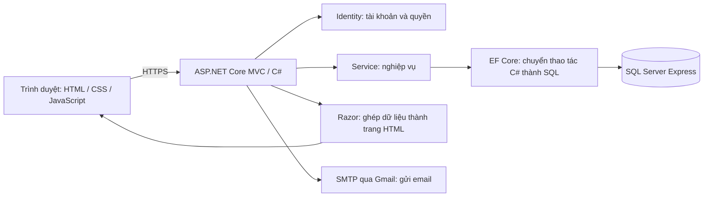

# GS – Web đặt lịch học gia sư online

Dự án học phần **Phát triển dự án Công nghệ thông tin**, Nhóm 8. GS kết nối học viên với gia sư, quản lý hồ sơ và kiểm duyệt; các sprint tiếp theo bổ sung đặt lịch, thanh toán và học trực tuyến.

**Cập nhật: 29/10/2026 (UTC+7). Đã hoàn thiện chức năng lõi và SMTP Sprint 1; chờ nhóm nghiệm thu cuối.** Đây là nơi theo dõi tiến độ và hướng dẫn cấu hình chính của repository. Không cần Trello để chạy ứng dụng; nhóm chọn theo dõi tại README.

- [Chạy trên máy](#chay-du-an)
- [Cấu hình Gmail SMTP](#smtp)
- [Thử các chức năng](#thu-chuc-nang)
- [Tiến độ từng task](#tien-do)
- [Giải thích các thành phần](#thanh-phan)
- [Xử lý lỗi thường gặp](#xu-ly-loi)

<a id="thanh-phan"></a>
## 1. Các thành phần liên kết với nhau



| Thành phần | Vai trò | Có bắt buộc để chạy không? |
| --- | --- | --- |
| .NET 10 SDK | Biên dịch và chạy máy chủ C#, cú pháp gần Java | Có; Setup tải SDK cục bộ nếu máy chưa có |
| ASP.NET Core MVC | Nhận yêu cầu từ trình duyệt, xử lý và trả trang | Có, nằm trong project |
| Razor + Bootstrap + HTML/CSS/JS | Giao diện và thao tác trên trình duyệt | Có; Bootstrap đã lưu trong wwwroot, không cần npm |
| Identity | Băm mật khẩu, đăng nhập, khóa tài khoản, phân quyền | Có, tải bằng NuGet |
| EF Core | Ánh xạ class thành bảng, tạo/truy vấn SQL và migration | Có, tải bằng NuGet |
| SQL Server Express | Lưu tài khoản, hồ sơ và môn học | Dùng mặc định; có SQLite để học thử |
| SSMS | Công cụ để người lập trình xem dữ liệu SQL Server | Không cần để web chạy, nhưng hữu ích khi học SQL |
| SMTP | Chuyển email của ứng dụng đến hộp thư thật | Cần để nghiệm thu gửi thư thật; chế độ Pickup vẫn chạy được trên máy |
| Git/GitHub | Quản lý lịch sử mã nguồn, phối hợp và review | Không cần khi chỉ chạy bản đã tải về |
| Trello/Jira | Quản lý công việc nhóm | Không cần; bỏ qua theo lựa chọn nhóm |

Chi tiết ví dụ “bấm Lưu hồ sơ → Controller → Service → SQL → Razor” ở [HOW_IT_WORKS](docs/design/HOW_IT_WORKS.md). [ERD Sprint 1](database/diagrams/SPRINT_1_ERD.md) mô tả bảng và quan hệ.

<a id="chay-du-an"></a>
## 2. Chạy trên Windows

### 2.1. Chuẩn bị lần đầu

- Windows, PowerShell 5.1 hoặc PowerShell 7, Git và trình duyệt Edge/Chrome.
- SQL Server Express đang hoạt động; biết tên máy chủ và tài khoản có quyền tạo database. SSMS là công cụ quản trị, không thay SQL Server.
- Internet để tải SDK/thư viện lần đầu. Mã hiện dùng SDK **10.0.403**, EF Core/Identity **10.0.14**.

```powershell
git clone https://github.com/hhai0410/GiaSuTrucTuyenGS.git
cd GiaSuTrucTuyenGS

# Chỉ cần trên máy khác LOQ: thay bằng tên SQL Server của máy bạn.
$env:ConnectionStrings__DefaultConnection = 'Server=TENMAY\SQLEXPRESS;Database=GiaSuOnlineGS;Trusted_Connection=True;TrustServerCertificate=True;Connect Timeout=10'

powershell -ExecutionPolicy Bypass -File .\scripts\Setup.ps1
```

Nếu đang ở máy LOQ của nhóm, không đặt dòng connection string mẫu. Mặc định là `LOQ\SQLEXPRESS`, database riêng `GiaSuOnlineGS`, xác thực Windows. `TrustServerCertificate=True` dành cho SQL Server phát triển trên máy; triển khai thực tế cần chứng chỉ SQL Server được tin cậy và cấu hình phù hợp.

Setup tải SDK vào `.tools/dotnet` nếu cần, tải thư viện, build, áp dụng migration vào database và yêu cầu tin cậy chứng chỉ HTTPS phát triển. Bạn tự xác nhận hộp thoại Windows. Nếu máy có SDK khác nhưng không đáp ứng `global.json`, cài .NET SDK 10.0.403 hoặc phiên bản 10.0 mới hơn tương thích.

### 2.2. Khởi động

```powershell
# Trên máy này, nếu bản xem thử nền còn chạy, dừng trước khi biên dịch/chạy lại:
powershell -ExecutionPolicy Bypass -File .\scripts\Stop-Preview.ps1

# Chạy bình thường
powershell -ExecutionPolicy Bypass -File .\scripts\Start.ps1
```

Mở **https://localhost:7043**. Giữ terminal mở; nhấn Ctrl+C để dừng. `http://localhost:5043` chuyển sang HTTPS. Các script đã lưu **UTF-8 có BOM**, đọc được tiếng Việt trong Windows PowerShell 5.1.

Trên máy mới chưa có admin:

```powershell
powershell -ExecutionPolicy Bypass -File .\scripts\Start.ps1 -CreateAdmin
```

Nhập email quản trị mới và mật khẩu khi được hỏi. Không dùng email đã tự đăng ký: seed không tự nâng quyền tài khoản đang tồn tại. Trên máy LOQ, thông tin quản trị thử đã có tại `.local/admin-login.txt`, chỉ mở trên máy; không đưa tệp này lên GitHub.

### 2.3. Chạy thử khi chưa có SQL Server hoặc chưa muốn gửi thư thật

```powershell
# SQLite demo + email lưu trên máy, không gửi qua Gmail
powershell -ExecutionPolicy Bypass -File .\scripts\Start.ps1 -Sqlite -PickupEmail -CreateAdmin
```

SQLite lưu riêng tại `src/GiaSuOnline.Web/App_Data/gs-dev.db`, không tự đồng bộ sang SQL Server. Chế độ này dùng EnsureCreated để tạo schema demo; migration trong repository dành cho SQL Server.

<a id="smtp"></a>
## 3. Cấu hình Gmail SMTP

SMTP là giao thức để ứng dụng gửi thư qua nhà cung cấp email. GS dùng cho **xác nhận đăng ký, quên mật khẩu và kết quả duyệt hồ sơ**. Không phải tạo một tài khoản Gmail cho mỗi học viên; chỉ cần một tài khoản gửi của nhóm.

### 3.1. Ý nghĩa từng thông tin

| Thông tin | Gmail | Ý nghĩa |
| --- | --- | --- |
| Host | `smtp.gmail.com` | Địa chỉ máy chủ nhận yêu cầu gửi thư |
| Port | `587` | Cổng kết nối SMTP có STARTTLS |
| UseStartTls | `true` | Bắt buộc nâng kết nối lên TLS trước khi đăng nhập |
| From / Sender | Gmail gửi của nhóm | Địa chỉ học viên nhìn thấy là người gửi |
| Username | Cùng Gmail gửi | Tài khoản để đăng nhập SMTP |
| Password | Mật khẩu ứng dụng Google | Nhập riêng trên máy; không dùng mật khẩu Google thông thường |
| Người nhận thư thử | Email mà bạn sở hữu/được phép gửi tới | Kiểm tra thư thực sự đến hộp thư; không phải cấu hình gửi cố định cho mọi email |
| PublicOrigin | `https://localhost:7043` khi chạy local | Địa chỉ gốc dùng tạo link xác nhận/reset |

Khi triển khai lên tên miền thật, đổi `PublicOrigin` và `AllowedHosts` cho đúng máy chủ. Link localhost chỉ mở đúng ứng dụng trên máy đang chạy; người khác không thể xác nhận qua localhost của bạn từ máy họ.

### 3.2. Tạo mật khẩu ứng dụng

1. Đăng nhập tài khoản Gmail gửi.
2. Bật xác minh hai bước nếu chưa có.
3. Mở [Mật khẩu ứng dụng Google](https://myaccount.google.com/apppasswords), tạo mục riêng cho GS.
4. Dùng mật khẩu ứng dụng 16 ký tự vừa được Google cung cấp ở bước cấu hình dưới đây. Script tự bỏ khoảng trắng khi dán và từ chối chuỗi không đủ 16 ký tự; kiểm tra này không thay việc xác thực với Google. Không gửi vào chat, không ghi trong README hoặc appsettings đã commit.

Một số loại tài khoản không hiển thị lựa chọn này; xem [hướng dẫn chính thức của Google](https://support.google.com/accounts/answer/185833?hl=vi). Nếu không có tùy chọn, cần dùng phương án được tài khoản hỗ trợ (ví dụ OAuth), không tắt bảo vệ tài khoản để thử đăng nhập thường.

### 3.3. Nhập trên máy và lưu mã hóa

```powershell
# Thay email mẫu bằng Gmail của bạn; script sẽ hỏi mật khẩu một cách kín.
powershell -ExecutionPolicy Bypass -File .\scripts\Configure-Smtp.ps1 -Sender "email-cua-ban@gmail.com"
```

Các giá trị Gmail Host/Port/TLS được điền sẵn. Hai tệp riêng trên máy:

- `.local/smtp.json`: cấu hình máy chủ/người gửi, không chứa mật khẩu.
- `.local/smtp-credential.xml`: mật khẩu được Windows DPAPI mã hóa cho tài khoản Windows hiện tại trên máy này.

Cả thư mục `.local/` đã bị Git bỏ qua. Không chia sẻ cả tệp đã mã hóa; mỗi thành viên tự cấu hình. Nếu đổi tài khoản Windows/máy hoặc thu hồi mật khẩu Google, chạy lại Configure-Smtp. Không nhập mật khẩu ngay trong tham số dòng lệnh hoặc lịch sử shell.

`Start.ps1` tự nạp cấu hình riêng khi cả hai tệp tồn tại. Nếu chưa cấu hình, Development dùng Pickup. Muốn chủ động thử offline dù đã cấu hình Gmail: chạy `Start.ps1 -PickupEmail`.

### 3.4. Gửi một thư kiểm tra

Sau khi build thành công và trước khi khởi động web (thư kiểm tra và ba email nghiệp vụ đã được xác minh trên máy nhóm ngày 29/10/2026):

```powershell
# Thay địa chỉ mẫu bằng hộp thư nhận bạn cho phép.
powershell -ExecutionPolicy Bypass -File .\scripts\Test-Smtp.ps1 -To "email-nhan@example.com"
```

Lệnh dùng chính EmailSender của ứng dụng, không cần kết nối SQL Server và không mở endpoint gửi thư công khai. “Máy chủ SMTP đã chấp nhận” nghĩa là máy chủ đã nhận yêu cầu; cần người nhận kiểm tra Hộp thư đến/Spam để xác nhận giao thư cuối cùng. Lệnh này không thay việc kiểm thử các email nghiệp vụ.

### 3.5. Cấu hình bằng môi trường khi triển khai

Không dùng tệp DPAPI của một máy cho máy chủ khác. Ứng dụng hỗ trợ `Email__Mode`, `Email__Host`, `Email__Port`, `Email__From`, `Email__Username`, `Email__Password`, `Email__UseStartTls`, `PublicOrigin`, `AllowedHosts` và `ConnectionStrings__DefaultConnection` từ biến môi trường/secret store của môi trường triển khai. Không đặt bí mật trong repository. Nhà cung cấp cần OAuth phải có tích hợp OAuth tương ứng; script hiện dành cho SMTP dùng mật khẩu ứng dụng/credential được nhà cung cấp hỗ trợ.

<a id="thu-chuc-nang"></a>
## 4. Thử chức năng Sprint 1

1. **Gia sư:** đăng ký vai trò Tutor → mở thư xác nhận → đăng nhập → tạo hồ sơ (giới thiệu từ 20 ký tự, học phí dương, ít nhất một môn, ảnh JPG/PNG và chứng chỉ JPG/PNG/PDF; mỗi tệp tối đa 5 MB) → gửi duyệt.
2. **Admin:** đăng nhập ở cửa sổ riêng → Kiểm duyệt → mở hồ sơ/chứng chỉ → duyệt hoặc từ chối với lý do. Email kết quả được gửi qua cấu hình đang dùng.
3. **Khách:** chỉ thấy hồ sơ đã duyệt. Hồ sơ chờ duyệt hoặc không tồn tại trả 404. Gia sư sửa hồ sơ đã duyệt thì quay lại chờ duyệt và ẩn khỏi công khai.
4. **Tài khoản:** thử quên mật khẩu, token 30 phút và dùng một lần; sai mật khẩu 5 lần thì khóa 15 phút; đăng xuất hủy phiên.
5. **Quyền:** Student không vào khu vực Admin/Tutor; chứng chỉ chỉ chủ hồ sơ/Admin được tải.

Nếu dùng Pickup, mở tệp `.txt` mới nhất trong `src/GiaSuOnline.Web/App_Data/mail/`, kiểm tra đúng người nhận rồi mở link. Đây là email thử trên máy, không đến Gmail thật. Các tệp thư chứa token nên không được commit.

Trang chi tiết đã có nút Đặt lịch và trang khung giờ; **chưa tạo booking trong Sprint 1**. Khi lịch/đánh giá chưa có dữ liệu, trang hiển thị trạng thái rỗng; tạo lịch và đánh giá thuộc sprint sau.

## 5. Kiểm thử

Dừng bản web đang chạy trước khi build/kiểm thử để tránh Windows khóa file:

```powershell
powershell -ExecutionPolicy Bypass -File .\scripts\Stop-Preview.ps1
powershell -ExecutionPolicy Bypass -File .\scripts\Test.ps1
```

Bộ kiểm thử dùng SQLite in-memory và email giả lập, không xóa database SQL Server. Có kiểm chứng bổ sung luồng thật với SQL Server. Xem [bằng chứng kiểm thử](docs/testing/SPRINT_1_RESULTS.md) và các kịch bản nghiệm thu thủ công còn chờ.

<a id="tien-do"></a>
## 6. Tiến độ dự án

### Lộ trình từ workbook

| Giai đoạn | Kế hoạch | Phạm vi | Trạng thái |
| --- | --- | --- | --- |
| Sprint 1 | 26/10–13/11/2026 | US01, US02, US03, US04, US06, US19 | Đã triển khai và kiểm chứng email thật; chờ nhóm nghiệm thu cuối |
| Sprint 2 | 16/11–04/12/2026 | US05, US07, US08, US09: tìm kiếm/lọc, lịch rảnh, đặt và xác nhận | Chưa triển khai nghiệp vụ; mục tiêu phát hành V1.0 |
| Sprint 3 | 07/12–25/12/2026 | US12, US14, US20: thanh toán sandbox, video, UAT/triển khai | Chưa triển khai; mục tiêu phát hành V2.0 |
| Mở rộng | Chưa cam kết | US10, US11, US13, US15–US18 | Chỉ làm khi được nhóm đưa vào phạm vi |

### Kết quả và việc còn chờ

- Đã áp dụng migration vào `LOQ\SQLEXPRESS / GiaSuOnlineGS`; đã seed ba vai trò và sáu môn học.
- Luồng SQL Server thật đã chạy với **Gmail SMTP**: đăng ký tài khoản thử riêng → người dùng mở email xác nhận → đăng nhập → tạo hồ sơ → admin duyệt → khách xem. Người dùng đã nhận email duyệt, mở email đặt lại mật khẩu, đổi mật khẩu và đăng nhập lại thành công.
- Bộ kiểm thử mở rộng: **21/21 đạt**, gồm 14 ca lõi và 7 ca cấu hình email/TLS, từ chối cấu hình sai và chặn Pickup ngoài Development.
- Gmail SMTP: **đã cấu hình, xác thực TLS và gửi/nhận thành công**. Đã nhận thư kiểm tra và đủ ba email nghiệp vụ (xác nhận tài khoản, kết quả duyệt, đặt lại mật khẩu). Lỗi `5.7.9` ban đầu đã được khắc phục bằng mật khẩu ứng dụng hợp lệ. Mật khẩu chỉ lưu mã hóa trên máy, không ở GitHub.
- GitHub CLI: đã kiểm tra đăng nhập thành công ngày 29/10/2026. Mã Sprint 1 có trên `main`. Cập nhật cấu hình SMTP và README thực hiện bằng commit trực tiếp vào `main` theo xác nhận của chủ repository; chưa có PR/review độc lập của thành viên khác.
- Trello/Jira: bỏ qua theo lựa chọn nhóm; tiến độ thể hiện tại README này.
- Còn chờ nhóm thử giao diện trên desktop/mobile, review/acceptance, Sprint Review/Retrospective. Không tạo biên bản hoặc ghi giờ công giả.

### Đối chiếu đủ 29 task Sprint 1

Nguồn: `docs/Nhom8_Scrum_GiaSuOnline.xlsx`, sheet `Sprint backlog 1`, tổng 124 giờ dự kiến. “Đã triển khai” mô tả mã đã có; không đồng nghĩa toàn bộ task đã được nhóm nghiệm thu. Không sửa trạng thái/giờ thực tế trong workbook thay nhóm.

| Task | Công việc | Trạng thái thực tế | Bằng chứng / giới hạn |
| --- | --- | --- | --- |
| T01.1 | Thiết kế CSDL người dùng | Đã triển khai, đã áp dụng SQL Server | Identity, unique email; migration; seed Student/Tutor/Admin; ERD |
| T01.2 | Xử lý đăng ký (Controller/Service) | Đã triển khai và xác minh Gmail thật | AccountController, Identity, EmailSender; Gmail thật đã nhận và mở link xác nhận thành công |
| T01.3 | Giao diện đăng ký | Đã triển khai; chờ nhóm xem giao diện | Views/Account/Register.cshtml, Bootstrap, validation server và HTML |
| T01.4 | Kiểm thử đăng ký | Đã kiểm thử tự động | RegistrationHashesPasswordSeedsRolesAndSendsConfirmation; RegistrationRejectsInvalidInputs |
| T01.5 | Review code & merge | Chưa hoàn tất quy trình | Mã có trên main, build và kiểm thử đạt; chưa có PR/review của thành viên khác |
| T02.1 | Đăng nhập / đăng xuất | Đã triển khai và kiểm thử | AccountController; khóa 5 lần/15 phút; logout đổi security stamp |
| T02.2 | Quên / đặt lại mật khẩu | Đã triển khai và kiểm thử; Gmail thật đã đạt | Identity token 30 phút; kiểm thử dùng lại/hết hạn đạt; người dùng đã reset qua Gmail và đăng nhập bằng mật khẩu mới |
| T02.3 | Giao diện đăng nhập & quên mật khẩu | Đã triển khai; chờ nhóm xem giao diện | Login, EmailForm, ResetPassword, Message |
| T02.4 | Kiểm thử đăng nhập | Đã kiểm thử tự động | LockoutAfterFiveFailuresForFifteenMinutes; ResetTokenSingleUseAndInvalidatesOldPassword; ExpiredResetTokenRejected |
| T02.5 | Review code & merge | Chưa hoàn tất quy trình | Mã Sprint 1 đã có commit trên main; chưa có PR và review độc lập |
| T03.1 | Thiết kế CSDL hồ sơ gia sư | Đã triển khai, đã áp dụng SQL Server | TutorProfile, TutorSubject, Subject; migration; seed 6 môn; ERD |
| T03.2 | CRUD hồ sơ gia sư | Đã triển khai và kiểm thử | ProfileService; form chỉ nhận dữ liệu cho phép; sửa luôn Pending; concurrency token |
| T03.3 | Upload ảnh và chứng chỉ | Đã triển khai và kiểm thử | UploadStore: JPG/PNG/PDF, kiểm tra signature, tối đa 5 MB/tệp, tên ngẫu nhiên, App_Data ngoài wwwroot |
| T03.4 | Giao diện form hồ sơ nhiều bước | Đã triển khai; chờ nhóm thử trực quan | Stepper 3 bước, kiểm tra client/server, ảnh xem trước; cần kiểm tra desktop/mobile thật |
| T03.5 | Trang xem hồ sơ cá nhân | Đã triển khai và kiểm thử HTTP | Mine: thông tin, trạng thái, lý do từ chối, liên kết tệp có quyền |
| T03.6 | Kiểm thử hồ sơ gia sư | Đã kiểm thử tự động | InvalidUploadsRejected; InvalidPriceRejectedAndSqlInputDoesNotChangeSchema; ProfileApprovalRejectionEditingPrivacyAndXssEndToEnd |
| T19.1 | Thiết lập repo Git, quy ước nhánh, bảng công việc | Hoàn thành một phần | Có repo main, CONTRIBUTING và mẫu PR; dùng README theo dõi công việc, bỏ qua Trello theo lựa chọn nhóm; nhánh/PR còn chờ |
| T19.2 | Cấu hình HTTPS/HSTS | Đã cấu hình; HTTPS cục bộ đã chạy | Chứng chỉ .NET đã trust; HTTP→HTTPS kiểm thử; HSTS bật ngoài Development, cần kiểm tra tại môi trường triển khai |
| T19.3 | Chống CSRF/XSS/SQL Injection | Đã triển khai và kiểm thử cơ bản | AutoValidateAntiforgeryToken, Razor encode, EF Core query tham số, CSP, cookie Secure/HttpOnly |
| T19.4 | Phân quyền theo vai trò | Đã triển khai và kiểm thử | Authorize theo role; kiểm tra chủ sở hữu tệp; trang 403/404 tùy chỉnh |
| T19.5 | Kiểm thử bảo mật cơ bản | Đã kiểm thử tự động cơ bản | CSRF→400, sai role→403, HTTP→308, script bị encode, SQL input không thay đổi schema; không thay thế kiểm thử bảo mật đầy đủ |
| T04.1 | Trạng thái hồ sơ gia sư | Đã triển khai, đã áp dụng SQL Server | ProfileStatus Pending/Approved/Rejected, RejectionReason và Revision |
| T04.2 | Trang admin danh sách chờ duyệt | Đã triển khai; chờ nhóm xem giao diện | Admin/Profiles: lọc trạng thái, danh sách, chi tiết và tải chứng chỉ |
| T04.3 | Chức năng duyệt / từ chối | Đã triển khai và kiểm thử | Moderate kiểm tra Pending/Revision, từ chối bắt buộc lý do; chống duyệt hồ sơ đã đổi |
| T04.4 | Email kết quả duyệt | Đã triển khai và xác minh Gmail thật | EmailSender MailKit dùng chung; Gmail thật đã nhận email duyệt; có báo lỗi và nút gửi lại khi cần |
| T04.5 | Kiểm thử duyệt hồ sơ | Đã kiểm thử tự động và thử SQL Server | Luồng pending→reject→resubmit→approve; pending không công khai |
| T06.1 | Giao diện trang chi tiết gia sư | Đã triển khai; phần booking giới hạn Sprint 1 | Trang chi tiết và nút Đặt lịch dẫn tới trang khung giờ; chưa tạo booking Sprint 2 |
| T06.2 | Dữ liệu đánh giá và lịch rảnh tóm tắt | Đã triển khai phần đọc; chưa có chức năng tạo dữ liệu | Truy vấn 5 đánh giá gần nhất và slot trống 7 ngày tới; trạng thái rỗng trung thực; tạo lịch/đánh giá theo sprint sau |
| T06.3 | Kiểm thử trang chi tiết | Đã kiểm thử tự động và thử SQL Server | Hồ sơ đã duyệt→200, chưa duyệt/ID không tồn tại→404, nút dẫn trang khung giờ |


### Lưu ý kế hoạch

Hàng ngày trong sheet Sprint backlog 1 có ô công thức cached `#REF!`; cần kiểm tra công thức trước khi dùng biểu đồ burndown làm minh chứng. US06 có phần đọc lịch/đánh giá trong khi tạo lịch/đánh giá nằm ở sprint sau: nhóm cần nghiệm thu rõ trạng thái chưa có dữ liệu thay vì xem đây là chức năng booking/đánh giá đã hoàn thành.

## 7. Tổ chức repository và quy trình làm việc

```text
src/GiaSuOnline.Web/    Ứng dụng MVC, Identity, dữ liệu, dịch vụ email và giao diện
  Controllers/         Nhận request của khách/học viên/gia sư
  Areas/Admin/         Giao diện và xử lý quản trị
  Models/              Thực thể tài khoản/hồ sơ/môn học
  ViewModels/          Dữ liệu form, không cho tự sửa quyền/trạng thái nội bộ
  Services/            Nghiệp vụ hồ sơ và lưu tệp riêng tư
  Data/Migrations/     Lịch sử cấu trúc bảng SQL Server
  Integrations/Email/  EmailSender và kiểm tra cấu hình SMTP
  Views/, wwwroot/     Razor, Bootstrap, CSS và JavaScript
scripts/               Chuẩn bị môi trường, chạy, cấu hình SMTP và kiểm thử
tests/                Kiểm thử HTTP, nghiệp vụ và cấu hình email
database/diagrams/    ERD
docs/                  Tài liệu nguồn, thiết kế, kiểm thử, hướng dẫn học phần
.local/, .tools/       Cấu hình riêng, công cụ cục bộ (không đưa lên Git)
```

[Xem quy ước đóng góp](CONTRIBUTING.md). Một thay đổi nên gắn mã US/task, chạy kiểm thử và được thành viên khác review trước khi merge. GitHub authentication chỉ cho phép thao tác repository; không tự thay thế review của con người. Không đưa mật khẩu SMTP, tài khoản demo, tệp người dùng, email có token hoặc thư mục build lên Git.

<a id="xu-ly-loi"></a>
## 8. Lỗi thường gặp

| Hiện tượng | Cách kiểm tra |
| --- | --- |
| `dotnet` không nhận | Chạy Setup.ps1; script dùng `.tools/dotnet`, không bắt buộc sửa PATH toàn máy |
| Lỗi không kết nối SQL | Kiểm tra SQL Server Express đang chạy, tên instance đúng và quyền Windows; thử cùng tên máy chủ trong SSMS |
| `Unexpected token` hoặc tiếng Việt thành `Cần...` | Script cần UTF-8 có BOM cho Windows PowerShell 5.1. Bản hiện tại đã sửa; không lưu lại thành ANSI |
| Cổng đang dùng hoặc file exe bị khóa | Dừng terminal đang chạy web; bản xem thử nền thì dùng Stop-Preview.ps1 rồi thử lại |
| Chứng chỉ localhost không được tin cậy | Chạy `.tools/dotnet/dotnet.exe dev-certs https --trust`, tự xác nhận Windows rồi mở lại trình duyệt; không bỏ qua cảnh báo mù quáng |
| Không nhận email, chỉ có file trong App_Data | Đang dùng Pickup. Cấu hình SMTP và khởi động lại bằng Start.ps1 |
| Gmail báo `5.7.9 Application-specific password required` | Kiểm tra đúng Gmail, xác minh hai bước và mật khẩu ứng dụng còn hiệu lực; không dùng mật khẩu đăng nhập Google |
| Không giải mã được smtp-credential.xml | Tệp tạo từ máy/tài khoản Windows khác; chạy Configure-Smtp trên chính máy và tài khoản đang dùng |
| SMTP đã chấp nhận nhưng chưa thấy thư | Kiểm tra Spam, người nhận và độ trễ; chưa ghi nhận “đã đến hộp thư” cho đến khi người nhận xác nhận |
| Link xác nhận/reset không mở đúng web | PublicOrigin phải đúng địa chỉ bản đang chạy; localhost không dùng thay địa chỉ triển khai công khai |

## Tài liệu nguồn

- [Kế hoạch Scrum của nhóm](docs/Nhom8_Scrum_GiaSuOnline.xlsx).
- [Danh mục tài liệu học phần](docs/README.md).
- [Google: mật khẩu ứng dụng](https://support.google.com/accounts/answer/185833?hl=vi).
- [Google: SMTP và TLS](https://developers.google.com/workspace/gmail/imap/imap-smtp).

README ở thư mục gốc là nguồn hướng dẫn/tiến độ chính; không để một README khác trong `.github/` che nội dung này khi GitHub chọn file hiển thị.
