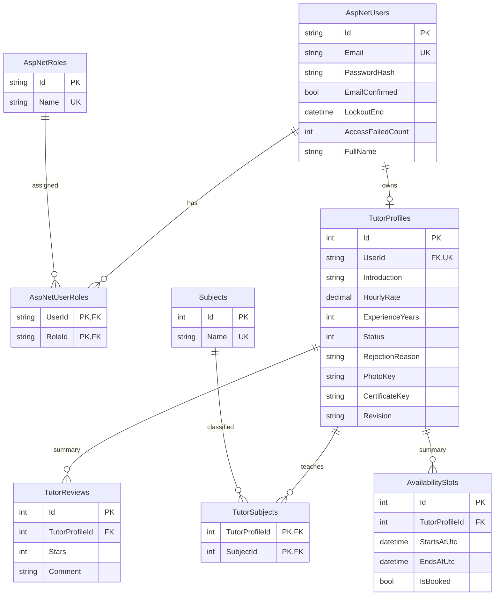

# ERD Sprint 1

Identity còn tạo bảng claim, login ngoài và token theo cấu trúc chuẩn của thư viện. Email chuẩn hóa có unique index. Một tài khoản chỉ có tối đa một hồ sơ gia sư. TutorSubjects dùng khóa ghép; không xóa môn đang được hồ sơ sử dụng.

`Revision` là concurrency token: ngăn ghi đè hoặc duyệt phiên bản hồ sơ đã bị thay đổi ở tab khác. `PhotoKey`/`CertificateKey` là tên tệp ngẫu nhiên, không phải đường dẫn công khai. Status: 0 Pending, 1 Approved, 2 Rejected.

TutorReviews/AvailabilitySlots hiện chỉ hỗ trợ đọc tóm tắt US06. Quan hệ với booking/học viên và quy tắc chống trùng/đánh giá sẽ hoàn thiện ở sprint tương ứng; chưa cho phép ghi từ giao diện.

Migration SQL Server: `src/GiaSuOnline.Web/Data/Migrations/*_InitialSprintOne.cs`; schema đã áp dụng bằng EF Core vào GiaSuOnlineGS.
