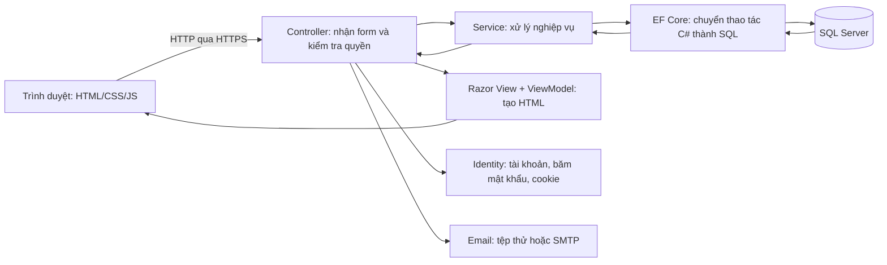

# Các phần liên kết với nhau như thế nào?

Bạn không cần dùng tất cả ngôn ngữ đã học trong một dự án. Dự án này chọn C# cho máy chủ vì backlog đã dùng ASP.NET Core Identity/EF Core. C# có class, method, interface, async khá gần Java; kiến thức HTML/CSS/JS và SQL của bạn được dùng trực tiếp.

Ví dụ gia sư bấm Lưu hồ sơ:

1. `Views/TutorProfiles/Edit.cshtml` tạo form HTML. `site.js` giúp chia bước và xem trước ảnh; Bootstrap và `site.css` quyết định bố cục/màu sắc.
2. Trình duyệt gửi POST đến `TutorProfilesController.Edit`. Cookie chứng minh đã đăng nhập; `[Authorize(Roles="Tutor")]` kiểm tra đúng vai trò. Anti-forgery token chống một trang khác lén gửi form thay người dùng.
3. Controller nhận `ProfileForm`, kiểm tra trường bắt buộc, học phí, môn học và tệp. Kiểm tra trong JS chỉ giúp nhập nhanh; kiểm tra ở máy chủ mới quyết định có chấp nhận hay không.
4. `ProfileService.SaveAsync` đọc đúng hồ sơ của tài khoản đang đăng nhập, đặt Chờ duyệt và cập nhật môn dạy. `UploadStore` đặt tên ngẫu nhiên, lưu tệp trong App_Data ngoài wwwroot.
5. `ApplicationDbContext` của EF Core tạo câu SQL có tham số và gửi SQL Server. Bạn không phải tự ghép chuỗi SQL từ dữ liệu người dùng.
6. Sau khi lưu thành công, trình duyệt chuyển sang Hồ sơ của tôi. Controller đọc dữ liệu, Razor kết hợp dữ liệu với HTML rồi trả trang mới.

## Vai trò các công cụ

| Thành phần | Có thể hiểu là | File chính |
| --- | --- | --- |
| .NET SDK | Bộ biên dịch và công cụ chạy C# | `global.json`, `.csproj` |
| ASP.NET Core MVC | Khung nhận request và trả trang | `Program.cs`, Controllers, Views |
| Razor | HTML có chỗ điền dữ liệu bằng C# | `.cshtml` |
| Identity | Thư viện quản lý tài khoản | AccountController, ApplicationUser |
| EF Core | Cầu nối giữa object C# và bảng SQL | ApplicationDbContext |
| Migration | Bản ghi thay đổi cấu trúc bảng | Data/Migrations |
| SQL Server Express | Chương trình lưu trữ/truy vấn CSDL | Database GiaSuOnlineGS |
| SSMS | Cửa sổ để người lập trình xem CSDL | Không thuộc mã web |
| Git/GitHub | Lưu lịch sử và phối hợp mã | Repository/nhánh/PR |

## Bắt đầu đọc mã theo thứ tự

1. `Program.cs`: cấu hình kết nối, Identity, dịch vụ, bảo mật, route.
2. `Models/Entities.cs` và `database/diagrams/SPRINT_1_ERD.md`: biết dữ liệu được tổ chức ra sao.
3. `ViewModels/Forms.cs`: biết form nhận những gì; không cho form tự sửa trường quyền/trạng thái.
4. `TutorProfilesController.cs` → `Services/ProfileService.cs` → `Views/TutorProfiles/`: theo một luồng hoàn chỉnh.
5. `AccountController.cs`: đăng ký, xác nhận, đăng nhập và quên mật khẩu.
6. `tests/GiaSuOnline.IntegrationTests/SprintOneTests.cs`: các điều kiện phải giữ đúng khi sửa mã.

## Phân quyền không chỉ là ẩn nút

Ẩn nút quản trị trên HTML giúp giao diện gọn hơn, nhưng người khác vẫn gõ được URL. Máy chủ phải kiểm tra `[Authorize]`, quyền sở hữu tệp và trạng thái hồ sơ mỗi lần truy cập. Identity băm mật khẩu; không tự viết thuật toán băm hoặc lưu mật khẩu gốc.

## Ranh giới Sprint 1

Bảng đánh giá/lịch rảnh mới phục vụ đọc tóm tắt US06; chưa có màn hình tạo chúng. Booking là trang giải thích/chờ khung giờ, chưa nhận đặt lịch. Các sprint sau sẽ bổ sung quy tắc và quan hệ dữ liệu khi triển khai US07–US09 và US15. Không dùng cấu trúc đọc trước này làm bằng chứng các story sau đã hoàn thành.
