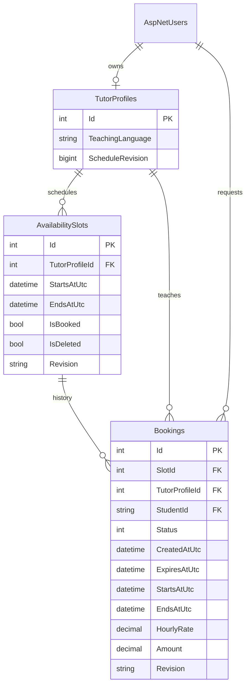

# Thiết kế Sprint 2

## Bảo vệ đặt trùng và lịch chồng lấn

Mỗi thao tác ghi lịch/booking mở transaction rồi cập nhật ScheduleRevision của cùng TutorProfile bằng ExecuteUpdate. SQL Server giữ khóa ghi đến commit: các request/instance cùng gia sư phải lần lượt đọc lại và kiểm tra lịch. SQLite cũng nhận khóa ghi trước khi đọc trạng thái. Không dùng khóa trong bộ nhớ một web server.

Sau khi lấy khóa, service đọc lại slot, trạng thái duyệt, thời gian tương lai và revision. BookForm chỉ chứa ID/revision, không chứa StudentId/Amount đáng tin cậy. StudentId lấy từ phiên đăng nhập; giá tính trên máy chủ và lưu snapshot với thời gian. Unique filtered index trên SlotId khi Status IN (0,1) là lớp bảo vệ cuối: một slot chỉ có một Pending/Confirmed; lịch sử Rejected/Expired vẫn giữ.

Sửa/xóa slot phải đúng chủ, đúng revision và IsBooked=false. Xóa mềm bảo toàn lịch sử. Chấp nhận giữ slot, từ chối/hết hạn mở slot; mọi thay đổi này dùng cùng khóa transaction. Có kiểm thử SQL Server cho tranh slot, tranh lịch chồng lấn và race xác nhận/hết hạn.

## Thời gian và hạn phản hồi

SQL lưu UTC; form và UI dùng giờ Việt Nam UTC+7. FullCalendar render giờ Việt Nam độc lập múi giờ máy; request API chuyển lại UTC. Yêu cầu hết hạn sau 24 giờ hoặc trước khi giờ học đã bắt đầu. Worker quét 30 giây, xử lý bù lúc khởi động; quyết định confirm cũng kiểm tra hạn ngay trong transaction.

## Thông báo

BookingEmails là outbox nội bộ: recipient, subject, body, thời điểm thử lại, lease/token, attempts, SentAt và loại lỗi. Ghi thư cùng transaction với booking. Worker nhận thư bằng compare-and-update với lease 5 phút, gửi EmailSender hiện có rồi ghi SentAt; thất bại retry 2–60 phút. Không ghi mật khẩu SMTP hoặc exception đầy đủ. Đây là giao thư ít nhất một lần, có khả năng trùng nếu crash sau khi SMTP đã nhận thư.

## Nguồn kỹ thuật

- [EF Core: transaction](https://learn.microsoft.com/en-us/ef/core/saving/transactions).
- [EF Core: ExecuteUpdate và concurrency](https://learn.microsoft.com/en-us/ef/core/saving/execute-insert-update-delete).
- [FullCalendar 6: CSP nonce](https://legacy.fullcalendar.io/v6/content-security-policy).
- FullCalendar 6.1.22 standard bundle/MIT được lưu trong wwwroot/lib/fullcalendar, không tải CDN khi người dùng mở web.
